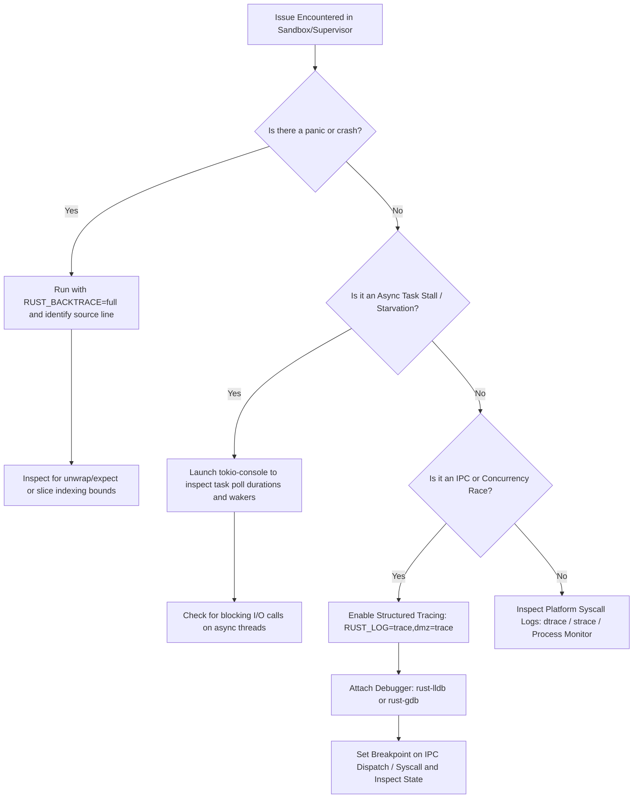

# DMZ Audit & Review Guide

**Version**: 2.0  
**Target Rust Standards**: Edition 2021 / 2024-Ready | POSIX.1-2017 | NIST SP 800-218

---

## 1. Executive Charter & Autonomous Governance Standard

### 1.1 Purpose and Zero-Dependency Mandate
The DMZ platform operates as a secure, air-gapped developer workspace and containerless isolation engine. It eliminates host daemon dependencies (e.g., Docker, systemd, system-wide runtimes) by enforcing user-space hermetic toolchains, OS-native sandboxing (macOS Seatbelt, Linux User Namespaces, Windows Job Objects), and volatile supervisor orchestration.

Because DMZ executes in environments with zero external network connectivity and under strict compliance postures (defense, financial infrastructure, air-gapped intelligence labs), code quality cannot rely on post-deployment telemetry, external patch managers, or permissive fault recovery. Every module, trait, dependency, and syscall must adhere to uncompromising engineering standards.

This document serves as the **Autonomous Repository-Wide Audit & Review Guide**. It establishes an independent, self-contained standard for auditing existing code across all workspace crates and evaluating every future pull request.

### 1.2 Ground-Anchor Mappings & Authoritative Verification Sources
Every principle, pattern, and anti-pattern in this guide is grounded in verified, authoritative documentation and industry standards:

* **The Rust Reference & Rust API Guidelines**:
  * [The Rust Reference](https://doc.rust-lang.org/reference/): Formal language semantics, memory model, drop order, and undefined behavior boundaries.
  * [The Rust API Guidelines](https://rust-lang.github.io/api-guidelines/): Complete 10-category checklist (Naming, Interoperability, Macros, Documentation, Predictability, Flexibility, Type Safety, Dependability, Debuggability, Future Proofing), including conversion conventions (`C-CONV`), custom error types (`C-CUSTOM-ERR`), smart pointers (`C-SMART-PTR`), and concurrency bounds (`C-SEND-SYNC`).
* **Rust Security, Advisory & Soundness Standards**:
  * [RustSec Advisory Database](https://rustsec.org/): Security vulnerability triage, dependency advisory policies, and CVE/RUSTSEC tracking.
  * [The Miri Project](https://github.com/rust-lang/miri): Undefined Behavior (UB) verification, pointer provenance, Stacked Borrows and Tree Borrows memory aliasing models.
* **Asynchronous Execution & Concurrency Guarantees**:
  * [Tokio Architecture & Concurrency Guides](https://tokio.rs/tokio/tutorial): Structured concurrency, cancellation safety, task isolation, and non-blocking I/O primitives.
  * [Tokio Console Diagnostic Specification](https://github.com/tokio-rs/console): Task poll profiling, waker tracking, stall detection, and executor starvation analysis.
* **Operating System & Kernel Isolation Standards**:
  * [IEEE Std 1003.1-2017 (POSIX.1-2017)](https://pubs.opengroup.org/onlinepubs/9699919799/): Process group signaling (`kill(2)`, `setpgid(2)`), directory file descriptors (`openat(2)`), and descriptor leak prevention (`FD_CLOEXEC`).
  * [Linux Kernel Documentation](https://www.kernel.org/doc/Documentation/): User namespaces (`namespaces(7)`), control groups v2 (`cgroups(7)`, `cgroup.kill`), safe file descriptor traversal (`openat2(2)` / `RESOLVE_BENEATH`), and process descriptors (`pidfd_open(2)`).
  * [Apple macOS Security Framework](https://developer.apple.com/documentation/security): Seatbelt (`sandbox-exec`) profile scheme syntax, path interpolation safety, and process containment.
  * [Microsoft Windows Process & Security Model](https://learn.microsoft.com/en-us/windows/win32/procthread/job-objects): Job Objects (`JOB_OBJECT_LIMIT_KILL_ON_JOB_CLOSE`), Named Pipe Security Descriptors (DACLs, `ImpersonateNamedPipeClient`), and token restriction.
* **Secure Software Engineering & Vulnerability Standards**:
  * [NIST SP 800-218 (Secure Software Development Framework)](https://csrc.nist.gov/pubs/sp/800/218/final): Software supply chain integrity, defense-in-depth, and verified build hermeticity.
  * [SEI CERT C / Rust Secure Coding Guidelines](https://wiki.sei.cmu.edu/confluence/display/c): Input validation, integer overflow elimination, privilege separation, and complete mediation.
  * [MITRE CWE (Common Weakness Enumeration)](https://cwe.mitre.org/): 
    * CWE-22 (Path Traversal / Zip Slip)
    * CWE-190 (Integer Overflow / Wraparound)
    * CWE-362 (Concurrent Execution using Shared Resource with Improper Synchronization / Race Conditions)
    * CWE-367 (Time-of-Check to Time-of-Use / TOCTOU)
    * CWE-391 (Unchecked Error Condition)
    * CWE-400 (Uncontrolled Resource Consumption / Decompression Bombs)
    * CWE-706 (Use of Incorrectly-Resolved Name or Reference)
    * CWE-732 (Incorrect Permission Assignment for Critical Resource)
  * [OWASP Secure Coding Practices](https://owasp.org/www-project-secure-coding-practices-quick-reference-guide/): Complete mediation, fail-safe defaults, least privilege, and input boundary validation.

### 1.3 Workspace Scope
The audit and review protocols defined herein govern all 5 workspace crates of the DMZ repository:
1. `dmz-core`: Hermetic toolchain discovery, archive packing/unpacking, workspace snapshotting, lockfile resolution, and VCS delta management.
2. `dmz-sandbox`: Containerless OS isolation kernels (Seatbelt, Linux Namespaces, Windows Job Objects), volatile filesystem mount controllers (`tmpfs`), and proxy filters.
3. `dmz-supervisor`: IPC server daemon (Unix Domain Sockets & Windows Named Pipes), KEP-753 compliant sidecar lifecycle orchestrator, collateral service runner, and AI agent sandboxed task runner.
4. `dmz-cli`: Command-line interface, subcommands (`export`, `import`, `shell`, `bundle`, `resolve`, `fetch`, `build`, `run`, `install`, `ecosystem`, `init`, `sandbox`), and exit telemetry.
5. `dmz-gui`: Eframe/Egui desktop graphical user interface, event loops, async bridge channels, and real-time supervisory telemetry dashboards.

---

## 2. Core Architectural Principles (Strict Adherence & Formal Rules)

### 2.1 SOLID Principles in Systems Rust

#### 2.1.1 Single Responsibility Principle (SRP)
* **Core Mandate**: A module, struct, or function must have one, and only one, reason to change. It must encapsulate exactly one cohesive system responsibility.
* **Systems Rust Application**:
  * In `dmz-core`, packaging logic (`AirGapExporter`) must solely orchestrate archive generation; it must never execute OS environment activation scripts or directly launch binaries.
  * In `dmz-supervisor`, IPC transport handlers (`IpcServer`) must solely serialize, deserialize, and authenticate socket payloads; they must delegate process lifecycle state mutations to `SidecarOrchestrator` or `AgentRunner`.
* **Violation Signatures**:
  * Stateful domain or orchestrator structs exceeding 10 fields representing divergent domains (e.g., mixing process IDs with GUI rendering state).
  * Functions exceeding 100 lines performing argument parsing, filesystem I/O, OS process launching, and logging in a single scope.
* **Heuristic Scope & Exemptions**:
  * Pure Data Transfer Objects (DTOs), configuration models (`WorkspaceConfig`), and `serde`-serializable schemas are explicitly **exempt** from the 10-field threshold because they represent passive data schemas rather than divergent behavioral responsibilities.
* **Hardened Review Rule**: If an orchestrator or domain struct requires mocks or stubs for 3 or more unrelated subsystems during testing, it violates SRP and must be decomposed into granular, focused components.

#### 2.1.2 Open/Closed Principle (OCP)
* **Core Mandate**: Software entities must be open for extension, but closed for modification. New platform behaviors, toolchain ecosystems, or storage targets must be added via trait implementation rather than mutating existing control flow branches.
* **Systems Rust Application**:
  * Toolchain discovery (`ToolchainDiscoverer` trait) must allow introducing a new compiler (e.g., Zig, Haskell, Swift) by adding a new struct implementing the trait in `dmz-core/src/toolchain/discovery/`, without modifying the central matching loops of other ecosystems.
  * Version control backends must implement the `VcsProvider` trait (`dmz-core/src/vcs/provider.rs`), allowing alternative VCS drivers (e.g., Jujutsu, Pijul, Mercurial) without altering Git provider routines.
* **Violation Signatures**:
  * Massive `match` statements across platform strings (`"linux" | "macos" | "windows"`) scattered throughout business logic rather than encapsulated behind platform-specific trait boundaries.
* **Hardened Review Rule**: Modifying core workflow code to support a new toolchain ecosystem is strictly forbidden. The new ecosystem must register cleanly through existing trait dispatch.

#### 2.1.3 Liskov Substitution Principle (LSP)
* **Core Mandate**: Implementations of a trait must be completely substitutable for the trait abstraction without altering the correctness or contract expectations of the client code.
* **Systems Rust Application**:
  * In `dmz-sandbox`, the `SandboxRunner` trait is implemented by `macOS` (Seatbelt), `Linux` (User Namespaces), and `Windows` (Job Objects). Each implementation must adhere to identical lifecycle contracts: `run_sandboxed` must synchronously or asynchronously wait for child process completion, return standard `ExitStatus`, enforce read-only closures, and clean up temporary mounts upon termination.
  * A mock or secondary implementation cannot silently ignore isolation flags or return fake success codes without executing the required containment.
* **Violation Signatures**:
  * Platform implementations that silently return `Ok(ExitStatus::default())` or `Ok(())` without executing the requested containment or operation on non-Unix/Windows platforms.
  * Methods returning `UnsupportedError` on standard trait contracts that clients expect to be universal.
* **Hardened Review Rule**: If an implementation cannot uphold the security invariants of a trait (e.g. inability to restrict network or filesystem access), it must fail loudly during initialization, not silently downgrade security during invocation.

#### 2.1.4 Interface Segregation Principle (ISP)
* **Core Mandate**: Clients should not be forced to depend upon methods or traits they do not use. Prefer small, focused traits over fat, monolithic interfaces.
* **Systems Rust Application**:
  * Avoid giant traits such as `WorkspaceEngine` that bundle archive extraction, dependency resolution, process execution, and GUI rendering.
  * Decompose into narrow, composable traits: `LockfileReader`, `LockfileWriter`, `ArchiveExtractor`, `ProcessSupervisor`.
* **Violation Signatures**:
  * Implementing a trait where multiple methods are stubbed with `unimplemented!()` or return `Err("Not applicable")`.
* **Hardened Review Rule**: Any trait implementation containing `unimplemented!()` or empty dummy methods is an automatic review rejection.

#### 2.1.5 Dependency Inversion Principle (DIP)
* **Core Mandate**: High-level modules should not depend on low-level modules; both should depend on abstractions. Abstractions should not depend on details; details should depend on abstractions.
* **Systems Rust Application**:
  * The `dmz-cli` commands should depend on abstract traits defined in `dmz-core` (`WorkspaceResolver`, `ArchiveManager`), injected via generics or dynamic trait objects (`Arc<dyn VcsProvider>`), rather than directly binding to concrete operating system syscall helpers.
* **Violation Signatures**:
  * Direct calls to concrete platform functions (`std::os::unix::fs::symlink`) embedded deep within generic high-level workflows.
* **Hardened Review Rule**: Platform-specific details must be isolated behind platform abstraction layers (`#[cfg(...)]` modules exposing unified, platform-neutral public APIs).

---

### 2.2 Keep It Simple Stupid (KISS)
* **Core Mandate**: Systems design is most robust when unnecessary complexity is ruthlessly eliminated. Simplicity is a prerequisite for security and auditability.
* **Systems Rust Application**:
  * Prefer straightforward standard library primitives (`std::fs`, `std::path::Path`, `std::process::Command`) and well-vetted static crates (`zstd`, `tar`, `serde`) over esoteric macro DSLs or deeply nested generic type cascades.
  * Avoid speculative state machines for synchronous operations that can be expressed as direct, linear procedural pipelines.
* **Violation Signatures**:
  * Complex macro rules generating standard CRUD methods that could be written in three lines of idiomatic Rust.
  * Multi-layered wrapper types around `PathBuf` that provide no type-state invariants or security guarantees beyond standard paths.
* **Hardened Review Rule**: If an implementation requires more than two layers of structural indirection to perform a single read/write operation, the author must justify the complexity or refactor to a direct, idiomatic pattern.

---

### 2.3 Don't Repeat Yourself (DRY)
* **Core Mandate**: Every piece of knowledge or business logic must have a single, unambiguous, authoritative representation within a system.
* **Systems Rust Application**:
  * Path canonicalization, workspace root resolution, and `.dmz` directory traversal logic must reside in a single location: `dmz-core::workspace`. Duplicate logic in `dmz-cli` subcommands must be eliminated.
  * Seatbelt Scheme profile generation strings and Linux namespace mount table constructions must be defined in canonical formatters, not copy-pasted across command handlers.
* **Violation Signatures**:
  * Identical blocks of path validation, fallback logic, or archive header parsing duplicated across 3 or more files.
* **Hardened Review Rule**: Duplicate logic spanning multiple crates must be factored into `dmz-core` utility modules.

---

### 2.4 You Aren't Gonna Need It (YAGNI)
* **Core Mandate**: Always implement things when you actually need them, never when you just foresee that you might need them.
* **Systems Rust Application**:
  * Do not create trait abstractions, configuration flags, or CLI parameters for hypothetical future toolchains, cloud sync providers, or remote daemon architectures that have no active consumers.
  * Prune unused enum variants, uninvoked helper functions, and speculative error codes.
* **Violation Signatures**:
  * Configuration flags in `dmz.toml` that have no corresponding execution logic in `dmz-core` or `dmz-sandbox`.
  * Public trait methods marked with `// Reserved for future use`.
* **Hardened Review Rule**: Any code introduced without an active caller in the production binary or test suite must be deleted before merging.

---

### 2.5 Separation of Concerns (SoC)
* **Core Mandate**: The codebase must be separated into distinct sections, such that each section addresses a separate concern.
* **Systems Rust Application**:
  * **Protocol Layer**: IPC serialization, deserialization, frame validation, and peer identity checking (`dmz-supervisor::ipc`).
  * **Business Layer**: Sidecar dependency calculation, shutdown timeouts, and agent memory monitoring (`dmz-supervisor::sidecar_orchestrator`).
  * **Platform Layer**: Native system calls, process groups, signals, and security profiles (`dmz-sandbox::platform`).
  * **Presentation Layer**: GUI widgets, reactive event handling, and terminal formatting (`dmz-gui`, `dmz-cli`).
* **Violation Signatures**:
  * GUI rendering functions invoking raw Unix system calls (`libc::kill`) directly rather than sending IPC requests to the supervisor daemon.
  * Core resolution algorithms printing ANSI colored output directly to stdout.
* **Hardened Review Rule**: Layers must interact strictly through defined unidirectional interfaces. Presentation layers must never invoke OS kernel sandboxing primitives directly.

---

### 2.6 Avoid Premature Optimization & Unsafe Code Governance
* **Core Mandate**: Optimize for correctness, memory safety, and architectural clarity first. Optimize for performance only based on empirical profiling data. Unsoundness is strictly unacceptable regardless of performance claims.
* **Systems Rust Application**:
  * Do not replace safe, idiomatic Rust code with `unsafe` pointers, custom allocators, or unchecked indexing (`get_unchecked`) without empirical benchmarks proving a critical path bottleneck.
  * Use static compiler optimization passes (`profile.release`: `opt-level = 3`, `lto = true`, `codegen-units = 1`) to achieve high throughput before introducing manual algorithmic complexity.
* **Violation Signatures**:
  * Unsafe pointer arithmetic introduced to parse JSON manifests that `serde_json` parses in sub-millisecond time.
  * `unsafe` blocks lacking explicit `// SAFETY:` invariant annotations.
* **Hardened Review Rule for `unsafe` Blocks**: Any `unsafe` block submitted must satisfy **both** of the following requirements:
  1. **Soundness & Documentation**: Must carry a preceding `// SAFETY:` comment explaining caller invariants, memory validity, and aliasing boundaries (enforced by `clippy::undocumented_unsafe_blocks`), and execute cleanly under **Miri** (`cargo miri test`) with zero Undefined Behavior.
  2. **Empirical Justification**: Must be accompanied by Criterion benchmark results demonstrating at least a 25% throughput gain on production-representative workloads.

---

### 2.7 Law of Demeter (Principle of Least Knowledge)
* **Core Mandate**: Each unit should have only limited knowledge about other units: only units "closely" related to the current unit. Talk only to your immediate friends.
* **Systems Rust Application**:
  * A function operating on a `WorkspaceConfig` should not traverse multiple internal fields: `config.project.toolchains.rust.binaries.cargo.path.to_str()`.
  * The struct must expose clean, cohesive accessor methods: `config.cargo_binary_path()`.
* **Violation Signatures**:
  * Code chains featuring 4 or more raw method/field dereferences (`a.b.c.d.get()`) that tightly couple the caller to the internal structure of unrelated nested objects.
* **Heuristic Exemptions**:
  * Fluent builder chains (`Command::new("cargo").arg("build").env("RUST_LOG", "info").spawn()`) and functional iterator pipelines (`iter().filter(...).map(...).collect()`) are idiomatic Rust patterns and are explicitly **exempt** from Law of Demeter violations.
* **Hardened Review Rule**: Encapsulate nested structural queries into high-level domain methods on the owning struct.

---

## 3. Anti-Pattern Catalog & Strict Avoidance Matrix

| # | Anti-Pattern Category | Severe Risk & Threat Vector | Detection Signature | Strict Mandate |
|---|---|---|---|---|
| **1** | **Hardcoded Values & Paths** | Security bypass, collisions, test flakiness, permission denial on non-standard hosts. | Literals like `"127.0.0.1:0"`, `"/tmp/*.sock"`, default port numbers in core logic. | **ALWAYS AVOID**. Resolve dynamically via runtime environment, config, or OS ephemeral allocators. |
| **2** | **Race Conditions (TOCTOU)** | Process orphan leaks, split-brain state, socket hijack, data corruption. | Read locks dropped before write locks (`read().await; ... write().await;`), TOCTOU file checks. | **ALWAYS AVOID**. Enforce atomic insertions (`Entry` API), atomic locks, and file locking. |
| **3** | **Fragile Implementations & Panics** | DoS, unexpected process termination in production, silent data loss. | `.unwrap()`, `.expect()`, unchecked slice indexing `slice[i]`, release integer overflow. | **ALWAYS AVOID**. Enforce typed errors (`thiserror`), safe `.get()`, and `overflow-checks = true`. |
| **4** | **Mock / Placeholder Paths** | False sense of security, unverified assumptions, broken production runtime. | Static mock responses in non-test code, simulated permission checks, dummy data. | **ALWAYS AVOID**. Non-test code must execute real system operations with verified results. |
| **5** | **Dead Code & Unused Logic** | Maintenance overhead, cognitive clutter, false audit surface area. | Compiler warnings (`dead_code`, `unused_variables`), commented-out blocks, uncalled functions. | **ALWAYS AVOID**. Delete all uninvoked code. Enforce zero-warning builds. |
| **6** | **Pseudo Facades** | Illusion of protection without kernel enforcement; bypassable security. | Environment-only proxies (`HTTP_PROXY`), user-space checks without OS sandbox confinement, `chroot`. | **ALWAYS AVOID**. Security boundaries must be enforced at the OS kernel level (`pivot_root`, cgroups). |
| **7** | **Code Vulnerabilities** | Arbitrary code execution, privilege escalation, unauthorized file overwrite. | Zip Slip (unvalidated tar/zip extraction), unvalidated peer UID/GID over IPC, unescaped Seatbelt paths. | **ALWAYS AVOID**. Canonicalize all paths, validate components, enforce least-privilege IPC authentication. |
| **8** | **Decompression Bombs & Resource Exhaustion (CWE-400)** | Denial of Service, host OOM crash, disk space exhaustion. | Unbounded extraction loops without entry counts or byte quotas. | **ALWAYS AVOID**. Enforce uncompressed byte quotas, max entry limits, and ratio tripwires. |
| **9** | **Async Reactor Blocking** | Thread pool starvation, dropped IPC heartbeats, latency spikes. | Calling `std::fs`, `tar::Archive::unpack`, or heavy hashing directly inside async tasks. | **ALWAYS AVOID**. Offload blocking I/O to `tokio::task::spawn_blocking` or use `tokio::fs`. |
| **10** | **Tokio Cancellation Unsoundness** | State loss, corrupted buffers, hung locks across cancellation points. | Using cancellation-unsafe operations (`read_exact`, multi-step updates) in `select!` or timeout branches. | **ALWAYS AVOID**. Ensure all cancelable async futures are cancel-safe or guarded by RAII rollbacks. |

---

### 3.1 Detailed Anti-Pattern Analysis & Detection

#### 3.1.1 Hardcoded Values, Paths, and Socket Bounds
* **Why it must be avoided**:
  * Hardcoding POSIX paths (such as `/tmp/dmz.sock`) causes immediate failures on Windows hosts, multi-user Linux environments (where `/tmp` has sticky bit collision risks), and NixOS environments lacking standard filesystem hierarchies.
  * **Unix Domain Socket Path Length Limits**: Under POSIX, `sockaddr_un.sun_path` is strictly limited to **104 bytes on macOS/BSD** and **108 bytes on Linux**. Generating long temporary paths containing UUIDs or deep workspace directories without length verification results in silent truncation or kernel `ENAMETOOLONG` failures.
* **Audit Detection Protocol**:
  * Grep for string literals containing `/tmp`, `/private/tmp`, `127.0.0.1`, `localhost`, or integer port constants outside designated configuration defaults.
  * Verify all socket binding routines check that `path.as_os_str().len() < 104`.
* **Remediation**:
  * Use `std::env::temp_dir()`, `XDG_RUNTIME_DIR` on Linux, and bounded randomized socket names. On Windows, use properly prefixed Named Pipes (`\\.\pipe\dmz-<uuid>`).

#### 3.1.2 Race Conditions & Concurrency Vulnerabilities (TOCTOU)
* **Why it must be avoided**:
  * Time-of-Check to Time-of-Use (TOCTOU, CWE-367): Checking if a resource exists (`Path::exists()`, checking a key in a map) and acting on it in a subsequent step introduces a window where another thread or process alters the state.
  * Zombie Process Accumulation: Spawning child processes without tracking process groups or asynchronous wait tasks results in leaked zombie processes that exhaust OS PID tables.
* **Audit Detection Protocol**:
  * Search for patterns where an `RwLock` or `Mutex` is acquired for a read check, dropped, and subsequently acquired for a write operation.
  * Search for child process spawning where the returned `Child` struct is not bound to a supervisor lifecycle monitor or RAII cleanup guard.
* **Remediation**:
  * Use atomic entry patterns: `match map.entry(key) { Entry::Vacant(e) => { ... e.insert(val); } Entry::Occupied(_) => { ... } }`.
  * Use atomic file creation flags (`OpenOptions::new().write(true).create_new(true)` / `O_CREAT | O_EXCL`).
  * Ensure all spawned processes are assigned to distinct process groups (`cmd.process_group(0)`) and killed recursively via their process group ID or Job Object upon termination.

#### 3.1.3 Fragile Implementations, Silent Panic Vectors & Integer Overflows
* **Why it must be avoided**:
  * Calling `.unwrap()` or `.expect()` in non-test production code causes the entire process or worker thread to panic when unexpected input, network partition, or permission denial occurs.
  * **Unchecked Slice Indexing (`slice[i]`)**: Direct indexing panics when indices are out of bounds. In production code, direct indexing introduces denial-of-service vulnerabilities identical to unwraps.
  * **Release Integer Overflows (CWE-190)**: Rust checks for integer overflow in debug mode, but by default wraps in release mode (`opt-level = 3`). When processing archive offsets, frame lengths, or file sizes, wrapping can cause buffer calculation errors.
* **Audit Detection Protocol**:
  * Run `cargo clippy -- -D clippy::unwrap_used -D clippy::expect_used -D clippy::panic -D clippy::indexing_slicing`.
  * Verify `[profile.release]` contains `overflow-checks = true`.
* **Remediation**:
  * Model all domain errors with explicit enums derived via `thiserror`.
  * Access slices and arrays using `.get()` or `.get_mut()` with explicit error handling.
  * Enable release overflow checking in `Cargo.toml`.

#### 3.1.4 Mock & Placeholder Implementations
* **Why it must be avoided**:
  * Placeholder code or hardcoded mock responses in production paths lead to catastrophic deployment bugs where systems pass superficial checks but fail under real workloads.
* **Audit Detection Protocol**:
  * Search for comments containing `TODO`, `FIXME`, `MOCK`, `STUB`, or `PLACEHOLDER`.
  * Search for functions returning hardcoded dummy structs in production crates.
* **Remediation**:
  * Replace all mock/stub structures in `src/` with dynamic implementations backed by actual system inspection. Mocks belong strictly within `tests/` directories.

#### 3.1.5 Dead Code & Unreachable Logic
* **Why it must be avoided**:
  * Dead code inflates binary footprints, misleads auditors into reviewing non-functional code, and creates vectors for accidental resurrection of outdated vulnerabilities.
* **Audit Detection Protocol**:
  * Inspect compiler warnings for `#![allow(dead_code)]` or `#![allow(unused)]`.
  * Run `cargo check` and enforce `#![deny(warnings)]`.
* **Remediation**:
  * Delete all unused functions, struct fields, and dead branches immediately.

#### 3.1.6 Pseudo Facades & Containerless Isolation Integrity
* **Why it must be avoided**:
  * A pseudo facade provides the surface appearance of a security guarantee without enforcing it at the kernel or network layer.
  * Example: Setting `HTTP_PROXY="http://127.0.0.1:0"` is a facade; applications can bypass environment variables and open raw TCP sockets.
  * Example: Relying on `chroot` without dropping capabilities; root users in user namespaces can break out of `chroot` easily.
* **Audit Detection Protocol**:
  * Verify whether isolation uses true OS kernel mechanisms: `CLONE_NEWNET`, Seatbelt `(deny network*)`, or Windows Filtering Platform (WFP).
  * On Linux, verify that filesystem isolation uses `pivot_root` on a private mount namespace rather than raw `chroot`.
* **Remediation**:
  * Enforce kernel-level containment. On Linux: drop network namespaces (`CLONE_NEWNET`), configure `/proc/self/setgroups` to `deny` before writing GID maps, set `PR_SET_NO_NEW_PRIVS`, and isolate mount trees via `pivot_root`.

#### 3.1.7 Code Vulnerabilities: Zip Slip, Symlinks & IPC Hijacking
* **Why it must be avoided**:
  * **Zip Slip (Path Traversal, CWE-22)**: Archives containing paths like `../../../../etc/shadow` or symlinks pointing outside the workspace can overwrite arbitrary host files.
  * **IPC Hijacking & Spoofing**: Accepting local socket connections without verifying peer identity allows unprivileged local users to control the supervisor daemon.
  * **Seatbelt Scheme Injection**: Formatting unescaped file paths into macOS Seatbelt `.sb` profiles allows arbitrary profile rule execution.
* **Audit Detection Protocol**:
  * Inspect all archive unpacking routines (`tar`, `zip`) for iterative path component validation.
  * Inspect IPC accept loops: On Unix, verify peer UID via `getpeereid` / `SO_PEERCRED`. On Windows, verify Named Pipe client token impersonation and enforce DACLs via `SECURITY_ATTRIBUTES`.
* **Remediation**:
  * Reject any archive entry containing `RootDir`, `Prefix`, or relative components escaping the extraction root.
  * Validate peer UID matches the running daemon UID on all incoming IPC connections before processing commands.

#### 3.1.8 Decompression Bombs & Resource Exhaustion (CWE-400)
* **Why it must be avoided**:
  * A 10 KB compressed archive expanding to 100 GB (Zip Bomb) can exhaust host disk space or cause an Out-Of-Memory (OOM) panic during extraction, crashing the supervisor.
* **Audit Detection Protocol**:
  * Search archive extraction loops for byte counting and entry limits.
* **Remediation**:
  * Enforce strict extraction limits:
    1. Maximum total uncompressed byte quota (e.g., 2 GB default, configurable).
    2. Maximum total entry count (e.g., 50,000 files).
    3. Compression ratio tripwire: Abort if ratio exceeds 100:1 for entries larger than 1 MB.

#### 3.1.9 Async Reactor Starvation & Blocking Operations
* **Why it must be avoided**:
  * Executing synchronous, blocking operations (`std::fs::File`, `tar::Archive::unpack`, `git2`, CPU-heavy cryptographic hashing) inside Tokio async worker threads freezes the runtime worker, stalling all other tasks scheduled on that thread.
* **Audit Detection Protocol**:
  * Search async functions for calls to `std::fs`, `std::process`, `tar::`, or long loops without await points.
* **Remediation**:
  * Offload all blocking operations to `tokio::task::spawn_blocking` or use asynchronous primitives (`tokio::fs`, `tokio::process`).

#### 3.1.10 Tokio Cancellation Unsoundness
* **Why it must be avoided**:
  * When an async future is dropped (e.g. timeout in `tokio::time::timeout` or losing branch in `tokio::select!`), if the future was halfway through modifying a shared data structure or writing a stream, state is permanently desynchronized.
* **Audit Detection Protocol**:
  * Search for multi-step async transactions that drop locks between steps without transactional rollback guards.
* **Remediation**:
  * Ensure cancellation safety. When multi-step operations must be cancelable, employ RAII rollback guards that undo reservations if dropped prematurely.

---

## 4. Production-Hardened 1:1 Refactoring Blueprints (Side-by-Side Code Diffs)

### 4.1 Hardened Archive Extraction: Component Normalization & Symlink Defense (CWE-22)

#### Fragile Anti-Pattern:
```rust
// FRAGILE: Path::starts_with DOES NOT normalize '..'!
// An attacker passing "foo/../../etc/shadow" bypasses starts_with because prefix components match!
// On Windows, silently does nothing and returns Ok(()), violating LSP.
pub fn extract_symlink(entry: &mut tar::Entry<impl Read>, dest: &Path, target_root: &Path) {
    let link_name = entry.link_name().unwrap().unwrap();
    let resolved = target_root.join(&link_name);
    if !resolved.starts_with(target_root) {
        panic!("Path traversal!");
    }
    #[cfg(unix)]
    std::os::unix::fs::symlink(&link_name, dest).unwrap();
}
```

#### Production-Hardened Pattern:
```rust
// PRODUCTION-HARDENED: Component normalization, root boundary checks, and cross-platform handling
use std::path::{Component, Path, PathBuf};
use thiserror::Error;

#[derive(Debug, Error)]
pub enum ExtractionError {
    #[error("I/O failure while accessing entry at {path:?}: {source}")]
    Io {
        path: PathBuf,
        #[source]
        source: std::io::Error,
    },
    #[error("Malformed archive: missing symlink target for {entry:?}")]
    MissingSymlinkTarget { entry: PathBuf },
    #[error("Security violation: path traversal detected in link target {target:?}")]
    PathTraversal { target: PathBuf },
    #[error("Security violation: destination {dest:?} escapes extraction root {root:?}")]
    DestinationOutOfBounds { dest: PathBuf, root: PathBuf },
    #[error("Unsupported platform: symlink extraction not supported without elevated privileges")]
    UnsupportedPlatform,
}

/// Safely normalizes and validates a relative path to ensure it cannot escape its parent root.
pub fn sanitize_relative_target(raw_target: &Path) -> Result<PathBuf, ExtractionError> {
    let mut depth: usize = 0;
    let mut normalized = PathBuf::new();

    for component in raw_target.components() {
        match component {
            Component::Normal(c) => {
                normalized.push(c);
                depth = depth.saturating_add(1);
            }
            Component::CurDir => {} // Ignore redundant '.'
            Component::ParentDir => {
                if depth == 0 {
                    // Attempted to pop above the base directory
                    return Err(ExtractionError::PathTraversal {
                        target: raw_target.to_path_buf(),
                    });
                }
                normalized.pop();
                depth -= 1;
            }
            Component::RootDir | Component::Prefix(_) => {
                // Absolute paths in archives are strictly forbidden
                return Err(ExtractionError::PathTraversal {
                    target: raw_target.to_path_buf(),
                });
            }
        }
    }

    Ok(normalized)
}

pub fn extract_symlink(
    entry: &mut tar::Entry<impl std::io::Read>,
    dest: &Path,
    target_root: &Path,
) -> Result<(), ExtractionError> {
    // 1. Verify destination is strictly within extraction root
    let canonical_root = target_root
        .canonicalize()
        .map_err(|e| ExtractionError::Io { path: target_root.to_path_buf(), source: e })?;

    if !dest.starts_with(&canonical_root) && !dest.starts_with(target_root) {
        return Err(ExtractionError::DestinationOutOfBounds {
            dest: dest.to_path_buf(),
            root: target_root.to_path_buf(),
        });
    }

    // 2. Extract and sanitize raw target link
    let raw_target = entry
        .link_name()
        .map_err(|e| ExtractionError::Io { path: dest.to_path_buf(), source: e })?
        .ok_or_else(|| ExtractionError::MissingSymlinkTarget { entry: dest.to_path_buf() })?;

    let safe_target = sanitize_relative_target(&raw_target)?;

    // 3. Platform-specific symlink creation with explicit failure handling
    #[cfg(unix)]
    {
        std::os::unix::fs::symlink(&safe_target, dest)
            .map_err(|e| ExtractionError::Io { path: dest.to_path_buf(), source: e })?;
        Ok(())
    }

    #[cfg(windows)]
    {
        // On Windows, creating symlinks requires SeCreateSymbolicLinkPrivilege or Developer Mode.
        // Never return a silent Ok(()); perform the operation or return an explicit error.
        let resolved = dest.parent().unwrap_or(target_root).join(&safe_target);
        if resolved.is_dir() {
            std::os::windows::fs::symlink_dir(&safe_target, dest)
                .map_err(|e| ExtractionError::Io { path: dest.to_path_buf(), source: e })?;
            Ok(())
        } else {
            std::os::windows::fs::symlink_file(&safe_target, dest)
                .map_err(|e| ExtractionError::Io { path: dest.to_path_buf(), source: e })?;
            Ok(())
        }
    }

    #[cfg(not(any(unix, windows)))]
    {
        Err(ExtractionError::UnsupportedPlatform)
    }
}
```

---

### 4.2 Hardened Concurrency: Safe Process Supervision & Cancellation Rollback

#### Fragile Anti-Pattern:
```rust
// FRAGILE: 
// 1. Dropping child when start_service finishes immediately SIGKILLs the process due to kill_on_drop(true)!
// 2. If cancelled during spawn, state remains permanently stuck in Starting.
// 3. Child handle is discarded, leaking zombies and losing exit codes.
pub async fn start_service(&self, name: String, cmd: &str) -> Result<u32, String> {
    self.services.write().await.insert(name.clone(), ServiceState::Starting);
    let child = tokio::process::Command::new(cmd).kill_on_drop(true).spawn().unwrap();
    let pid = child.id().unwrap();
    self.services.write().await.insert(name, ServiceState::Running(pid));
    Ok(pid) // <-- `child` drops here and SIGKILL is immediately sent!
}
```

#### Production-Hardened Pattern:
```rust
// PRODUCTION-HARDENED: Active process handle retention, RAII cancellation rollback guard
use std::collections::hash_map::Entry;
use std::collections::HashMap;
use std::sync::Arc;
use tokio::process::{Child, Command};
use tokio::sync::{broadcast, RwLock};

pub enum ServiceState {
    Starting,
    Running {
        pid: u32,
        exit_rx: broadcast::Receiver<i32>,
    },
    Failed(String),
}

/// RAII Guard that rolls back the "Starting" reservation if the spawning future is cancelled.
struct ReservationGuard<'a> {
    name: &'a str,
    services: &'a RwLock<HashMap<String, ServiceState>>,
    completed: bool,
}

impl<'a> Drop for ReservationGuard<'a> {
    fn drop(&mut self) {
        if !self.completed {
            // Task was cancelled before completion; roll back state synchronously or queue cleanup
            if let Ok(mut lock) = self.services.try_write() {
                if let Some(ServiceState::Starting) = lock.get(self.name) {
                    lock.remove(self.name);
                }
            }
        }
    }
}

pub struct HardenedServiceRunner {
    services: Arc<RwLock<HashMap<String, ServiceState>>>,
}

impl HardenedServiceRunner {
    pub async fn start_service(&self, name: String, program: &str, args: &[&str]) -> Result<u32, String> {
        // Step 1: Atomically check and reserve the service slot
        {
            let mut services = self.services.write().await;
            match services.entry(name.clone()) {
                Entry::Occupied(existing) => {
                    return Err(format!("Service '{}' already registered", name));
                }
                Entry::Vacant(vacant) => {
                    vacant.insert(ServiceState::Starting);
                }
            }
        }

        // Arm the cancellation rollback guard
        let mut guard = ReservationGuard {
            name: &name,
            services: &self.services,
            completed: false,
        };

        // Step 2: Spawn process with explicit environment isolation
        let mut cmd = Command::new(program);
        cmd.args(args)
            .env_clear() // Defense-in-depth: do not leak supervisor environment
            .kill_on_drop(false); // Retain lifecycle under supervisor monitor

        #[cfg(unix)]
        cmd.process_group(0); // Create dedicated process group

        let mut child = cmd.spawn().map_err(|e| {
            format!("Failed to spawn service '{}': {}", name, e)
        })?;

        let pid = child.id().unwrap_or(0);
        let (exit_tx, exit_rx) = broadcast::channel(1);

        // Step 3: Offload process supervision to a background monitor task
        // Ensures Child is actively awaited and reaped without blocking the caller
        let monitor_name = name.clone();
        let monitor_services = Arc::clone(&self.services);
        tokio::spawn(async move {
            let status = child.wait().await;
            let code = status.map(|s| s.code().unwrap_or(-1)).unwrap_or(-1);
            let _ = exit_tx.send(code);

            let mut services = monitor_services.write().await;
            services.remove(&monitor_name);
        });

        // Step 4: Transition to Running state and disarm rollback guard
        {
            let mut services = self.services.write().await;
            services.insert(name, ServiceState::Running { pid, exit_rx });
        }
        guard.completed = true;

        Ok(pid)
    }
}
```

---

### 4.3 Hardened Process Group Supervision: Safe Termination without Self-Suicide

#### Fragile Anti-Pattern:
```rust
// FRAGILE: 
// If pgid is 0, kill(0, sig) sends SIGTERM to the CALLER'S process group,
// immediately terminating the supervisor daemon itself!
// Lacks Drop implementation; leaked if task panics or drops early.
pub fn terminate_agent(pgid: i32) {
    unsafe {
        libc::kill(-pgid, libc::SIGKILL);
    }
}
```

#### Production-Hardened Pattern:
```rust
// PRODUCTION-HARDENED: Strict PGID bounds check, graceful escalation, and RAII Drop fallback
use std::sync::atomic::{AtomicBool, Ordering};
use std::sync::Arc;
use std::time::Duration;
use tokio::process::Child;

pub struct SupervisedChild {
    pub id: String,
    pub child: Child,
    #[cfg(unix)]
    pub pgid: Option<i32>,
    reaped: Arc<AtomicBool>,
}

impl SupervisedChild {
    pub fn new(id: String, child: Child, pgid: Option<i32>) -> Self {
        Self {
            id,
            child,
            #[cfg(unix)]
            pgid,
            reaped: Arc::new(AtomicBool::new(false)),
        }
    }

    /// Performs graceful shutdown: SIGTERM -> timeout -> SIGKILL escalation.
    pub async fn graceful_shutdown(mut self, timeout: Duration) {
        if self.reaped.load(Ordering::SeqCst) {
            return;
        }

        #[cfg(unix)]
        if let Some(pgid) = self.pgid {
            // CRITICAL DEFENSE: Never signal PGID <= 1.
            // pgid == 0 signals calling process group (supervisor suicide).
            // pgid == -1 / 1 signals all processes on the host.
            if pgid > 1 {
                // SAFETY: Signalling dedicated child process group with validated positive PGID.
                unsafe {
                    libc::kill(-pgid, libc::SIGTERM);
                }
            }
        }

        // Wait cooperatively for child to exit within timeout
        let wait_fut = self.child.wait();
        tokio::pin!(wait_fut);

        if tokio::time::timeout(timeout, &mut wait_fut).await.is_err() {
            tracing::warn!(id = %self.id, "Graceful shutdown timed out; escalating to SIGKILL");

            #[cfg(unix)]
            if let Some(pgid) = self.pgid {
                if pgid > 1 {
                    // SAFETY: Force-kill child process group on timeout.
                    unsafe {
                        libc::kill(-pgid, libc::SIGKILL);
                    }
                }
            }

            let _ = self.child.kill().await;
            let _ = self.child.wait().await;
        }

        self.reaped.store(true, Ordering::SeqCst);
    }
}

impl Drop for SupervisedChild {
    fn drop(&mut self) {
        // Fallback synchronous cleanup if struct is dropped without awaiting graceful_shutdown
        if !self.reaped.load(Ordering::SeqCst) {
            #[cfg(unix)]
            if let Some(pgid) = self.pgid {
                if pgid > 1 {
                    // SAFETY: Emergency SIGKILL fallback to eliminate process group leaks on panic/drop.
                    unsafe {
                        libc::kill(-pgid, libc::SIGKILL);
                    }
                }
            }

            #[cfg(windows)]
            {
                // On Windows, child process termination is enforced automatically if attached
                // to a Job Object configured with JOB_OBJECT_LIMIT_KILL_ON_JOB_CLOSE.
                let _ = self.child.start_kill();
            }

            self.reaped.store(true, Ordering::SeqCst);
        }
    }
}
```

---

## 5. End-to-End Multi-Layer Verification & Testing Suite

### 5.1 Static Analysis & Strict Compiler Gates

Every commit and pull request must execute clean against the zero-warning compiler and restriction profile:

```bash
# 1. Zero-Warning Compilation Gate
cargo check --workspace --all-targets

# 2. Strict Clippy Linter Gate (Zero Tolerance for Panics, Unchecked Slices & Undocumented Unsafe)
cargo clippy --workspace --all-targets -- \
    -D warnings \
    -D clippy::unwrap_used \
    -D clippy::expect_used \
    -D clippy::panic \
    -D clippy::todo \
    -D clippy::unimplemented \
    -D clippy::unreachable \
    -D clippy::undocumented_unsafe_blocks \
    -D clippy::indexing_slicing \
    -D clippy::cast_possible_truncation \
    -D clippy::cast_sign_loss \
    -D clippy::fallible_impl_from

# 3. Cargo Dependency Vulnerability Audit
cargo audit

# 4. Dependency License, Advisory, and Ban Validation
cargo deny check licenses advisories bans sources

# 5. Release Binary Compilation Gate
cargo build --release -p dmz-cli -p dmz-gui
```

#### Cargo Release Profile Mandate:
In `Cargo.toml`, release profiles must explicitly enable integer overflow checks:
```toml
[profile.release]
opt-level = 3
lto = true
codegen-units = 1
panic = "abort"
overflow-checks = true   # Mandatory: Prevents silent integer wrap in release mode
```

---

### 5.2 Dynamic Sanitizers, Miri Soundness & Fuzz Testing

#### 1. Miri Soundness Verification:
All crates containing `unsafe` blocks (`dmz-sandbox`, `dmz-core`) must pass Miri validation:
```bash
# Detects Undefined Behavior, invalid pointer provenance, and aliasing violations
cargo +nightly miri test -p dmz-core -p dmz-sandbox
```

#### 2. LLVM AddressSanitizer & ThreadSanitizer:
```bash
# AddressSanitizer (ASan) & LeakSanitizer (Linux / macOS)
# Note: -Zbuild-std is required to instrument the standard library
RUSTFLAGS="-Zsanitizer=address" cargo +nightly test \
    -Zbuild-std --target x86_64-unknown-linux-gnu --lib

# ThreadSanitizer (TSan) (Linux)
# Detects data races across asynchronous worker tasks and threads
RUSTFLAGS="-Zsanitizer=thread" cargo +nightly test \
    -Zbuild-std --target x86_64-unknown-linux-gnu --lib -- --test-threads=4
```

#### 3. Continuous Fuzz Testing (libFuzzer):
Untrusted archive extraction (`tar`, `zip`) and IPC frame parsing must be fuzzed continuously:
```bash
# Execute fuzz harness for tar extraction logic
cargo +nightly fuzz run fuzz_tar_extraction -- -max_total_time=300
```

---

### 5.3 Systematic Debugging & Async Telemetry Playbook

When troubleshooting complex isolation, IPC socket communication, or task stalls:



#### Async Profiling with `tokio-console`:
To detect worker thread starvation or tasks held across await points:
1. Build application with unstable tracing flags:
   ```bash
   RUSTFLAGS="--cfg tokio_unstable" cargo run --release -p dmz-cli -- supervisor start
   ```
2. In a separate terminal, launch `tokio-console`:
   ```bash
   tokio-console
   ```
3. Inspect task list: verify no task exceeds 10ms poll busy time or exhibits abnormal self-wake counts.

---

## 6. Autonomous Gatekeeper Audit Rubric & Scoring System

Every code change submitted to DMZ is evaluated against a 100-point gatekeeper scoring rubric. A minimum score of **90/100** is required for merge approval, with zero critical security or panic defects permitted.

### 6.1 The 100-Point Evaluation Matrix

```
┌─────────────────────────────────────────────────────────────┬──────────┐
│ Evaluation Pillar                                           │ Weight   │
├─────────────────────────────────────────────────────────────┼──────────┤
│ Pillar 1: Architecture, SOLID, KISS & Boundaries            │ 25 Pts   │
│ Pillar 2: Security Hardening, Soundness & Zero-Panic Policy │ 25 Pts   │
│ Pillar 3: Concurrency, Cancellation Safety & Lifecycle      │ 25 Pts   │
│ Pillar 4: Test Suite, Verification, Fuzzing & Supply Chain  │ 25 Pts   │
├─────────────────────────────────────────────────────────────┼──────────┤
│ Total Possible Score                                        │ 100 Pts  │
│ Minimum Approval Threshold                                  │ 90 Pts   │
└─────────────────────────────────────────────────────────────┴──────────┘
```

#### Pillar 1: Architecture, SOLID, KISS & Boundaries (25 Points)
* **Single Responsibility & Cohesion (7 Pts)**: Modules and structs have single, well-defined responsibilities. No god objects. Domain entities adhere to field limits; DTOs cleanly isolated.
* **Trait-Based Abstraction & OCP (6 Pts)**: Extensibility achieved through traits (`ToolchainDiscoverer`, `VcsProvider`) without mutating core algorithms.
* **KISS & Minimal Indirection (6 Pts)**: Standard library primitives favored; no premature macro DSLs or gratuitous generic wrappers.
* **DRY & Canonical Workspaces (6 Pts)**: Path canonicalization, file hashing, and environment builders unified in `dmz-core`.

#### Pillar 2: Security Hardening, Soundness & Zero-Panic Policy (25 Points)
* **Zero Panic Vectors in Production Code (8 Pts)**: Zero `.unwrap()`, `.expect()`, or unchecked slice indexing (`slice[i]`). All errors explicitly typed with `thiserror`.
* **Path Traversal & Zip Slip Defense (6 Pts)**: Archives validated via component normalization; `ParentDir` escaping and absolute targets strictly rejected.
* **Unsafe Soundness & Documentation (6 Pts)**: Every `unsafe` block documented with `// SAFETY:` explaining invariants; executes clean under Miri.
* **Kernel-Level Isolation & IPC Authentication (5 Pts)**: Peer identity validated via UID/GIDs or Windows DACLs. No pseudo-facade environment hacks.

#### Pillar 3: Concurrency, Cancellation Safety & Lifecycle (25 Points)
* **Race Condition & TOCTOU Elimination (8 Pts)**: Atomic reservations for process maps. Atomic file creation flags (`create_new(true)`).
* **Cancellation Safety & Transactional Rollbacks (7 Pts)**: Async operations guarded against partial drops in `select!` or timeout branches.
* **Process Group Supervision & Anti-Zombie Guarantees (6 Pts)**: Child process groups strictly guarded against `pgid <= 1`; synchronous `Drop` fallbacks enforced.
* **Non-Blocking Async Reactor (4 Pts)**: Blocking I/O (`std::fs`, archive unpacking) offloaded to `spawn_blocking`.

#### Pillar 4: Test Suite, Verification, Fuzzing & Supply Chain (25 Points)
* **Hermetic Unit & Integration Tests (8 Pts)**: Comprehensive tests covering success, edge cases, and failure modes without host pollution.
* **Clippy Restriction Lints & Zero Warnings (6 Pts)**: Clean pass under `-D warnings` and high-assurance restriction lints.
* **Fuzz Testing & Dynamic Sanitizers (6 Pts)**: Untrusted parsers covered by `cargo fuzz`; clean execution under ASan/TSan.
* **Air-Gap Supply Chain & Reproducible Builds (5 Pts)**: Verified offline dependency resolution (`cargo vendor`) and deterministic build outputs.

---

### 6.2 Pull Request Gatekeeper Checklist

Before opening or approving any pull request, reviewers must verify every checkbox:

- [ ] **Principles & Architecture**:
  - [ ] Changes adhere to SOLID, KISS, DRY, YAGNI, and SoC.
  - [ ] Domain orchestrators have focused responsibilities; DTOs decoupled from business logic.
  - [ ] No circular dependencies between workspace crates.
- [ ] **Panics & Error Handling**:
  - [ ] Zero instances of `.unwrap()`, `.expect()`, or `panic!()` in non-test code.
  - [ ] Zero instances of unchecked slice indexing (`slice[i]`); safe `.get()` used instead.
  - [ ] All errors use typed domain enums derived via `thiserror`.
  - [ ] No errors silently discarded (`let _ = ...`).
- [ ] **Unsafe Code & Soundness**:
  - [ ] Every `unsafe` block includes a mandatory `// SAFETY:` rationale comment.
  - [ ] Unsafe code executes with 0 errors under `cargo +nightly miri test`.
- [ ] **Concurrency & Lifecycle**:
  - [ ] No TOCTOU check-then-insert gaps on shared maps.
  - [ ] Async functions are cancellation-safe; cancelable multi-step operations have RAII rollback guards.
  - [ ] Process signals strictly guard against `pgid <= 1`.
  - [ ] Spawned child processes have RAII `Drop` handlers to eliminate zombie leaks.
  - [ ] No blocking filesystem or CPU-bound calls on Tokio async threads.
- [ ] **Security, Paths & DoS Defenses**:
  - [ ] No hardcoded IP addresses, port numbers, or absolute paths (`/tmp`).
  - [ ] Unix socket paths verified to not exceed OS limits (`< 104` bytes).
  - [ ] Archive extractions enforce component normalization and decompression limits (Zip Bomb checks).
  - [ ] IPC sockets enforce peer UID authentication and restrictive directory permissions (`0o700`).
- [ ] **Verification**:
  - [ ] `cargo check --workspace --all-targets` passes with 0 warnings.
  - [ ] `cargo clippy --workspace --all-targets -- -D warnings -D clippy::unwrap_used -D clippy::expect_used -D clippy::undocumented_unsafe_blocks -D clippy::indexing_slicing` passes cleanly.
  - [ ] `cargo test --workspace` passes cleanly.
  - [ ] `cargo fmt --all -- --check` passes.
  - [ ] `cargo build --release -p dmz-cli -p dmz-gui` passes.
  - [ ] Scored $\ge 90$ points against the Gatekeeper Rubric.
